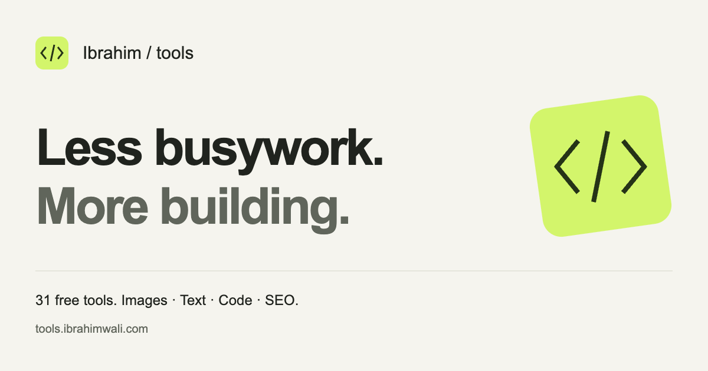

<div align="center">
  

  <h1>Ibrahim Tools</h1>

  <p><strong>Free online tools for images, text, developers, and SEO.</strong></p>
  <p>Less busywork. More building.</p>

  <p>
    <a href="https://github.com/Mibrahimwali/tools_ibrahimwali">GitHub</a> ·
    <a href="#tool-directory">Explore the tools</a> ·
    <a href="#quick-start">Run locally</a> ·
    <a href="#seo-and-ai-discoverability">SEO &amp; AI discovery</a> ·
    <a href="#deployment">Deploy</a> ·
    <a href="https://ibrahimwali.com">Meet the developer</a>
  </p>

  <p><strong>31 tools · 31 practical guides · No signup · Local processing</strong></p>
</div>



Ibrahim Tools is a collection of free browser utilities by **[Muhammad Ibrahim](https://ibrahimwali.com)**. Compress an image, format JSON, create a QR code, check contrast, or prepare a sitemap without an account or a file-upload service. Each tool includes instructions, FAQs, a dedicated guide, and links to related tools.

**Production domain:** [tools.ibrahimwali.com](https://tools.ibrahimwali.com). The project is configured for this address; publishing and DNS connection are separate deployment steps. For a local review, use [localhost:4175](http://127.0.0.1:4175).

This is an independently deployable React and TypeScript project. It includes its own dependencies, assets, content, build pipeline, and hosting configuration, and can be moved to a separate repository without importing anything from the portfolio.

## Why use Ibrahim Tools?

- **Start with the task.** Search the directory by tool name, category, or what you need to do. A separate search page also returns matching guides.
- **Keep inputs local.** Tool operations run on your device. Files, pasted text, dates, and generated results are not sent to an application backend.
- **Learn as you work.** Every tool has a guide explaining the workflow, examples, and limitations.
- **Keep useful tools close.** Favorites, recent tools, and your theme preference are saved in your browser.
- **Choose a comfortable workspace.** Light and dark themes, responsive layouts, keyboard focus indicators, and reduced-motion support are included.
- **Ask for context.** The floating **Ask AI** menu prepares a question about the public page for your chosen assistant.
- **Skip the overhead.** No account, advertising scripts, analytics tags, Supabase dependency, or paid AI API is required.

## Tool directory

All 31 tools below have an interactive workspace, FAQs, and a linked guide. The links use the configured production domain and become available when the site is deployed there.

### Image Tools (5)

- **[Image Compressor](https://tools.ibrahimwali.com/image-compressor)** — Shrink JPG, PNG, and WebP file size without leaving your browser. [Read the guide](https://tools.ibrahimwali.com/blog/image-compressor-guide).
- **[Image Resizer](https://tools.ibrahimwali.com/image-resizer)** — Resize photos to exact pixel dimensions for social, web, and print. [Read the guide](https://tools.ibrahimwali.com/blog/image-resizer-guide).
- **[JPG → PNG](https://tools.ibrahimwali.com/jpg-to-png)** — Convert JPG/JPEG photos to transparent-friendly PNG in one click. [Read the guide](https://tools.ibrahimwali.com/blog/jpg-to-png-guide).
- **[PNG → JPG](https://tools.ibrahimwali.com/png-to-jpg)** — Convert PNG images to smaller JPG files for web and email. [Read the guide](https://tools.ibrahimwali.com/blog/png-to-jpg-guide).
- **[WebP Converter](https://tools.ibrahimwali.com/webp-converter)** — Convert WebP images to JPG or PNG for apps that need classic formats. [Read the guide](https://tools.ibrahimwali.com/blog/webp-converter-guide).

### Text Tools (6)

- **[Word Counter](https://tools.ibrahimwali.com/word-counter)** — Count words, sentences, and reading time for essays, blogs, and SEO copy. [Read the guide](https://tools.ibrahimwali.com/blog/word-counter-guide).
- **[Character Counter](https://tools.ibrahimwali.com/character-counter)** — Count characters with and without spaces for titles, meta descriptions, and tweets. [Read the guide](https://tools.ibrahimwali.com/blog/character-counter-guide).
- **[URL Slug Generator](https://tools.ibrahimwali.com/slug-generator)** — Turn a title into a clean lowercase URL slug. [Read the guide](https://tools.ibrahimwali.com/blog/slug-generator-guide).
- **[Text Case Converter](https://tools.ibrahimwali.com/case-converter)** — Convert writing to sentence, title, upper, or lower case. [Read the guide](https://tools.ibrahimwali.com/blog/case-converter-guide).
- **[Remove Duplicate Lines](https://tools.ibrahimwali.com/remove-duplicate-lines)** — Deduplicate a list while preserving the first occurrence and original order. [Read the guide](https://tools.ibrahimwali.com/blog/remove-duplicate-lines-guide).
- **[Markdown Preview](https://tools.ibrahimwali.com/markdown-preview)** — Preview basic Markdown locally with raw HTML and remote images disabled. [Read the guide](https://tools.ibrahimwali.com/blog/markdown-preview-guide).

### Developer Tools (11)

- **[JSON Formatter](https://tools.ibrahimwali.com/json-formatter)** — Format, minify, and validate JSON with readable errors. [Read the guide](https://tools.ibrahimwali.com/blog/json-formatter-guide).
- **[Base64 Encoder & Decoder](https://tools.ibrahimwali.com/base64-encoder-decoder)** — Encode Unicode text as Base64 or decode it back to text. [Read the guide](https://tools.ibrahimwali.com/blog/base64-encoder-decoder-guide).
- **[URL Encoder & Decoder](https://tools.ibrahimwali.com/url-encoder-decoder)** — Encode a query parameter or decode percent-escaped text. [Read the guide](https://tools.ibrahimwali.com/blog/url-encoder-decoder-guide).
- **[UUID Generator](https://tools.ibrahimwali.com/uuid-generator)** — Generate version 4 UUIDs using your browser’s cryptographic random source. [Read the guide](https://tools.ibrahimwali.com/blog/uuid-generator-guide).
- **[SHA-256 Hash Generator](https://tools.ibrahimwali.com/sha256-generator)** — Calculate a SHA-256 digest for UTF-8 text locally. [Read the guide](https://tools.ibrahimwali.com/blog/sha256-generator-guide).
- **[Unix Timestamp Converter](https://tools.ibrahimwali.com/timestamp-converter)** — Convert Unix seconds or milliseconds into UTC dates and back. [Read the guide](https://tools.ibrahimwali.com/blog/timestamp-converter-guide).
- **[CSV to JSON Converter](https://tools.ibrahimwali.com/csv-to-json)** — Convert comma-separated records into a structured JSON array. [Read the guide](https://tools.ibrahimwali.com/blog/csv-to-json-guide).
- **[JSON to CSV Converter](https://tools.ibrahimwali.com/json-to-csv)** — Turn an array of JSON objects into a downloadable CSV file. [Read the guide](https://tools.ibrahimwali.com/blog/json-to-csv-guide).
- **[HTML Entity Encoder & Decoder](https://tools.ibrahimwali.com/html-entity-encoder-decoder)** — Escape HTML-sensitive text and decode common or numeric entities. [Read the guide](https://tools.ibrahimwali.com/blog/html-entity-encoder-decoder-guide).
- **[HEX / RGB / HSL Color Converter](https://tools.ibrahimwali.com/color-converter)** — Convert a solid HEX or RGB color into HEX, RGB, and HSL values. [Read the guide](https://tools.ibrahimwali.com/blog/color-converter-guide).
- **[Color Contrast Checker](https://tools.ibrahimwali.com/contrast-checker)** — Check foreground/background contrast against WCAG 2.x AA and AAA thresholds. [Read the guide](https://tools.ibrahimwali.com/blog/contrast-checker-guide).

### SEO Tools (4)

- **[Meta Tag Preview](https://tools.ibrahimwali.com/meta-tag-preview)** — Draft a title and description, preview a search snippet, and copy escaped HTML. [Read the guide](https://tools.ibrahimwali.com/blog/meta-tag-preview-guide).
- **[Robots.txt Generator](https://tools.ibrahimwali.com/robots-txt-generator)** — Create a simple robots.txt with optional disallow paths and a sitemap URL. [Read the guide](https://tools.ibrahimwali.com/blog/robots-txt-generator-guide).
- **[XML Sitemap Generator](https://tools.ibrahimwali.com/sitemap-generator)** — Build an escaped XML sitemap from a list of absolute page URLs. [Read the guide](https://tools.ibrahimwali.com/blog/sitemap-generator-guide).
- **[UTM Campaign URL Builder](https://tools.ibrahimwali.com/utm-builder)** — Create consistent campaign links without losing existing URL parameters. [Read the guide](https://tools.ibrahimwali.com/blog/utm-builder-guide).

### Calculators (3)

- **[Age Calculator](https://tools.ibrahimwali.com/age-calculator)** — Calculate exact age in years, months, and days from a date of birth. [Read the guide](https://tools.ibrahimwali.com/blog/age-calculator-guide).
- **[Percentage Calculator](https://tools.ibrahimwali.com/percentage-calculator)** — Find percentages, discounts, increases, and “what percent of” in seconds. [Read the guide](https://tools.ibrahimwali.com/blog/percentage-calculator-guide).
- **[Aspect Ratio Calculator](https://tools.ibrahimwali.com/aspect-ratio-calculator)** — Simplify an image aspect ratio and calculate proportional dimensions. [Read the guide](https://tools.ibrahimwali.com/blog/aspect-ratio-calculator-guide).

### Generators (2)

- **[QR Code Generator](https://tools.ibrahimwali.com/qr-code-generator)** — Create downloadable QR codes for URLs, text, Wi‑Fi, and more — free, private, instant. [Read the guide](https://tools.ibrahimwali.com/blog/qr-code-generator-guide).
- **[Password Generator](https://tools.ibrahimwali.com/password-generator)** — Create random passwords with selectable character sets. [Read the guide](https://tools.ibrahimwali.com/blog/password-generator-guide).

## Quick start

Use **Node.js 22.x** and npm. No API keys or database setup are needed to run the site.

Clone the standalone repository:

```sh
git clone https://github.com/Mibrahimwali/tools_ibrahimwali.git
cd tools_ibrahimwali
npm ci
npm run dev
```

If you are working from the portfolio checkout instead, enter its `tools-site` folder before running the npm commands.

Open **[http://127.0.0.1:4175](http://127.0.0.1:4175)**.

To inspect the production output:

```sh
npm run build
npm run preview
```

The preview serves the generated HTML and assets, including a real HTTP 404 for unknown addresses. It uses the same default port as the development server, so stop one before starting the other.

### Development commands

- `npm run dev` — start the Vite development server.
- `npm run check` — run TypeScript checks.
- `npm run lint` — lint application source.
- `npm test` — test parsing, calculations, conversions, and catalog integrity.
- `npm run build` — typecheck, build client and server bundles, generate pages and discovery files, then validate the output.
- `npm run preview` — serve the completed static site locally.
- `npm run test:browser` — test tool interactions, downloads, search, themes, AI links, and responsive layouts. Requires a completed build and an installed Google Chrome browser.
- `npm run og:render` — regenerate the social preview PNG from its SVG source. Requires Google Chrome.

## How the site works

The site uses **React 18, TypeScript, Vite, and Tailwind CSS**, with Lucide icons, locally hosted fonts, and the `qrcode` library. Vitest covers utility logic; Playwright checks the browser experience.

During a build, the server entry renders every registered page into a complete HTML document. The browser hydrates that document and loads the interactive workspace separately. A crawler can read the directory, articles, instructions, FAQs, and internal links directly from the HTML. Visitors need JavaScript to run the tools.

The current catalog generates **73 registered HTML pages**, plus a dedicated 404 document. New tools and guides are included through the central content registries.

### Project structure

```text
.
├── public/                       Branding, icons, and social preview assets
├── src/
│   ├── App.tsx                   Shared shell and page composition
│   ├── components/
│   │   ├── Directory.tsx         Search, category filters, and saved tools
│   │   ├── ToolRuntime.tsx       Interactive tool selection
│   │   ├── AskAI.tsx             Contextual assistant links
│   │   ├── ImageTool.tsx         Image processing workspaces
│   │   ├── EverydayTool.tsx      Counters and everyday calculators
│   │   ├── ExtraTool.tsx         Developer and SEO workspaces
│   │   └── AdditionalTool.tsx    CSV, Markdown, color, and related utilities
│   ├── data/
│   │   ├── tools.ts              Original tool catalog and shared types
│   │   ├── extra-tools.ts        Additional tools, FAQs, and examples
│   │   ├── guides.ts             Dedicated editorial guides
│   │   └── pages.ts              Routes, page metadata, and content date
│   ├── lib.ts                    Parsing, conversion, and calculation logic
│   ├── main.tsx                  Browser entry and hydration
│   └── entry-server.tsx          Static rendering entry
├── scripts/
│   ├── prerender.mjs             HTML, metadata, schemas, and discovery files
│   ├── check-site.mjs            Generated-page and internal-link validation
│   ├── browser-check.mjs         Browser interaction checks
│   ├── render-og.mjs             Social image rendering
│   └── serve.mjs                 Production preview server
├── migration/
│   └── portfolio-redirects.json   Redirects for the existing portfolio tool URLs
└── vercel.json                   Standalone hosting configuration
```

## SEO and AI discoverability

The site is designed to make its useful content readable and easy to navigate. It follows the approach described in [Google's JavaScript SEO guidance](https://developers.google.com/search/docs/crawling-indexing/javascript/javascript-seo-basics): meaningful HTML content, descriptive metadata, clear canonical URLs, and crawlable links.

### On-page and technical SEO

- **Complete HTML:** tool instructions and guide content are present in the initial response.
- **Page-specific metadata:** titles, descriptions, self-referencing canonicals, Open Graph, and Twitter cards.
- **Structured data:** `Person`, `WebSite`, `WebPage`, `SoftwareApplication`, `BlogPosting`, `ItemList`, `BreadcrumbList`, and `FAQPage`, according to the visible page content.
- **Connected content:** category → tool → guide → related tools and guides, with developer attribution.
- **Automatic discovery files:** sitemap, robots.txt, RSS, and a machine-readable content index.
- **Consistent URLs:** clean paths, canonical subdomain URLs, and configured aliases for `/tools` routes.
- **Index controls:** the dedicated search page is `noindex,follow`; missing pages have a real 404 response and a `noindex` document.
- **Honest modification dates:** the sitemap uses the editorial content date rather than stamping every page as newly updated on each build.

Structured data describes the content; it does not promise eligibility for a rich result, a ranking, or indexing.

### AI-readable documentation

The build generates several ways for AI assistants and other readers to understand the site:

- [`/llms.txt`](https://tools.ibrahimwali.com/llms.txt) — concise site introduction and tool directory organized by category.
- [`/llms-full.txt`](https://tools.ibrahimwali.com/llms-full.txt) — expanded tool and guide documentation.
- [`/search-index.json`](https://tools.ibrahimwali.com/search-index.json) — URLs, titles, descriptions, and content types.
- [`/index.md`](https://tools.ibrahimwali.com/index.md) — Markdown directory.
- `/{tool-slug}.md` — Markdown instructions and FAQs for an individual tool.
- `/blog/{tool-slug}-guide.md` — Markdown version of a tool guide.
- [`/feed.xml`](https://tools.ibrahimwali.com/feed.xml) — RSS feed of the guides.
- [`/sitemap.xml`](https://tools.ibrahimwali.com/sitemap.xml) — canonical, indexable page URLs.

HTML pages link to their Markdown companions. These files improve access to the content; `llms.txt` remains an emerging convention, and no file can guarantee that an AI service will search, cite, or recommend a page.

### The floating Ask AI menu

Visitors can ask an assistant about the page they are reading:

- **ChatGPT, Claude, and Perplexity:** open a link containing a prepared question where the platform supports prefilling.
- **Gemini and Microsoft Copilot:** copy the prepared question and open the platform for pasting.
- **Manual control:** the question is visible and can be copied before opening a service.

The prompt includes the **public page title and URL**. It never includes a visitor's tool inputs, generated passwords, files, or results. External platforms may require an account and can change their link behavior. Their own privacy policies apply after a visitor opens them.

## Privacy and practical limits

**Tool inputs stay in browser memory.** Images, pasted text, dates, and generated outputs are not uploaded to an application server. Reloading the workspace clears that input.

Only favorites, recently used tool slugs, and the selected theme are persisted in `localStorage`. Visitors can clear these preferences from the [privacy page](https://tools.ibrahimwali.com/privacy). Browser extensions, clipboard managers, the hosting provider, and external AI services have their own behavior and policies.

The tools expose their limitations rather than hiding them:

- Image files are limited to **20 MB and 24 megapixels**; output dimensions are capped at **10,000 pixels per side**.
- JPEG cannot preserve transparency; JPEG exports fill transparent areas with white.
- Passwords and UUIDs use browser cryptography. Generated secrets should be stored in a password manager, not shared with AI assistants.
- Base64 is encoding; SHA-256 is a digest. Neither provides encryption, and plain SHA-256 is not a password-storage scheme.
- CSV conversion validates headers and row lengths; JSON-to-CSV includes optional spreadsheet formula protection, enabled by default.
- The Markdown preview supports a documented subset and does not execute raw HTML or load remote images.
- The contrast checker evaluates solid sRGB colors against WCAG 2.x thresholds; it is not a full accessibility audit.
- Metadata previews are illustrative. Robots.txt controls cooperating crawlers, not access to private content.

No analytics or advertising scripts are included in this tools project. If tracking is introduced later, update the privacy documentation and implement the appropriate consent behavior before enabling it.

## Deployment

### Vercel and the custom subdomain

1. Import the repository as a **new Vercel project**.
2. If the tools remain inside the portfolio repository, set **Root Directory** to `tools-site`. If they have their own repository, use its root.
3. Select the Vite framework preset and use:
   - Install: `npm ci`
   - Build: `npm run build`
   - Output directory: `dist`
4. Add **`tools.ibrahimwali.com`** to the new project's Domains settings.
5. At your DNS provider, enter the exact record supplied by Vercel for that project. Wait for domain verification and HTTPS provisioning.
6. Open a tool and a guide directly, refresh them, and confirm that an unknown URL returns a 404.
7. Add the subdomain to Google Search Console or use a verified domain property that covers it, then submit [`sitemap.xml`](https://tools.ibrahimwali.com/sitemap.xml).

The static build can also be hosted elsewhere. The host must serve clean URLs from the generated `.html` files and return `404.html` with an HTTP 404 status for missing pages. Avoid a blanket rewrite that turns every missing address into a successful home-page response.

### Optional Search Console verification

Set this public verification token in the **new Vercel project's environment settings** before building:

```text
GOOGLE_SITE_VERIFICATION=your-google-verification-token
```

The build reads it from the process environment and emits a `google-site-verification` meta tag. The project does not require this variable for normal use. For a local verification build, pass it explicitly:

```sh
GOOGLE_SITE_VERIFICATION=your-google-verification-token npm run build
```

Do not place API secrets in frontend configuration or copy the portfolio's analytics setup without deciding how consent and cross-subdomain reporting should work.

### Move existing portfolio tool URLs safely

Publish and verify the new subdomain **before** redirecting existing visitors.

1. Merge the rules from [`migration/portfolio-redirects.json`](migration/portfolio-redirects.json) into the **portfolio's** top-level `vercel.json` redirects array.
2. Deploy the portfolio and verify that `/tools` and each existing `/tools/{slug}` permanently redirect to the matching new destination.
3. Update the portfolio's tool links and remove redirected tool URLs from its sitemap and LLM discovery generators.
4. Keep the redirects in place so old bookmarks and search results continue to resolve.

The standalone site's own `/tools/{slug}` aliases already redirect to `/{slug}`. Its canonical URLs point at `tools.ibrahimwali.com`.

## Add a new tool or guide

1. Add a catalog entry in [`src/data/extra-tools.ts`](src/data/extra-tools.ts) with a unique slug, description, category, instructions, FAQs, example, limitations, and related tools.
2. Implement its browser workspace and register it in [`ToolRuntime.tsx`](src/components/ToolRuntime.tsx).
3. Add a specific guide in [`src/data/guides.ts`](src/data/guides.ts). Explain the operation, show an example, and document meaningful limitations.
4. Add tests for parsing, calculations, validation errors, or other important behavior.
5. Update `CONTENT_DATE` in [`src/data/pages.ts`](src/data/pages.ts) when editorial content has actually changed.
6. Run checks and rebuild:

   ```sh
   npm run check
   npm run lint
   npm test
   npm run build
   npm run test:browser
   ```

The build derives routes and discovery files from the catalog. Its validation script checks internal references, canonical tags, descriptions, structured-data JSON, tool-to-guide relationships, and the presence of discovery files.

## Contributing

Bug reports, focused fixes, accessibility improvements, and useful tool ideas are welcome. Start with [CONTRIBUTING.md](CONTRIBUTING.md) for the local workflow and contribution expectations.

- [Report a bug](https://github.com/Mibrahimwali/tools_ibrahimwali/issues/new?template=bug_report.md).
- [Suggest a tool or improvement](https://github.com/Mibrahimwali/tools_ibrahimwali/issues/new?template=feature_request.md).
- Keep personal files, credentials, and private tool inputs out of public issues. For a sensitive vulnerability report, use the contact in [SECURITY.md](SECURITY.md).

## License

A project license has not been selected yet. Check for a `LICENSE` file before reusing or distributing the code. Third-party dependencies retain their respective licenses.

## Built by Muhammad Ibrahim

Technology executive, founder, and builder with **15+ years in software and technology**, focused on blockchain, real-world assets, and AI infrastructure.

- **Portfolio:** [ibrahimwali.com](https://ibrahimwali.com)
- **LinkedIn:** [Muhammad Ibrahim](https://www.linkedin.com/in/iamibrahimwali/)
- **GitHub:** [Mibrahimwali](https://github.com/Mibrahimwali)
- **Contact:** [connect@ibrahimwali.com](mailto:connect@ibrahimwali.com)
- **Business inquiries:** [ibrahim.wali@irussoft.com](mailto:ibrahim.wali@irussoft.com)

For feedback, include the tool name, your browser, what you expected, and what happened. Leave private inputs and credentials out of your message.

---

<div align="center">
  <strong>Useful things. A little less friction.</strong><br />
  <sub>Built by Muhammad Ibrahim · Free browser tools for everyday work.</sub>
</div>
